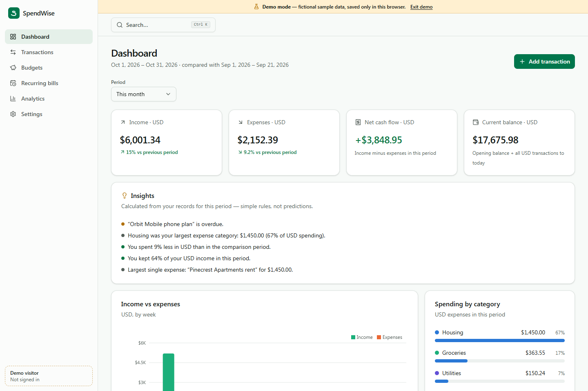
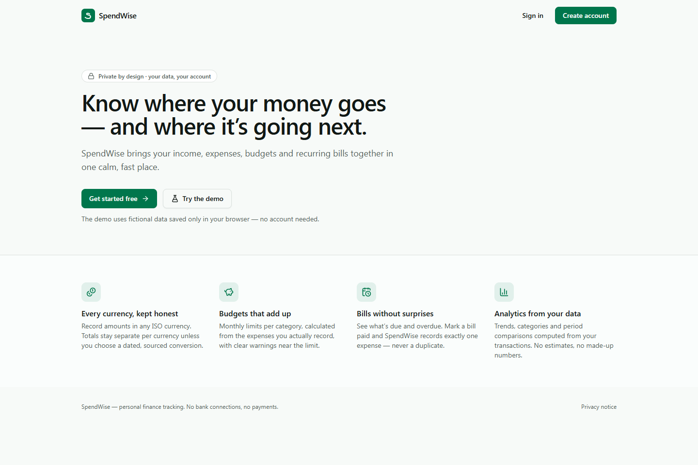
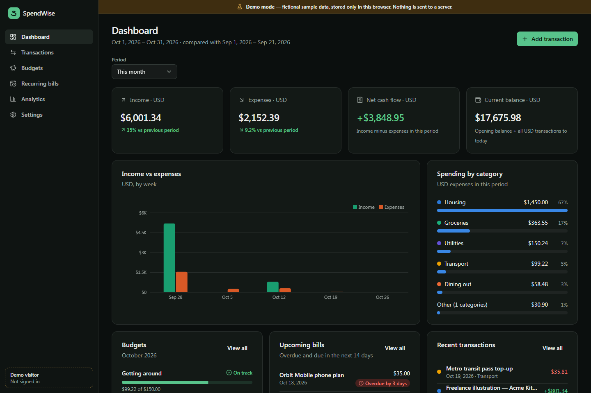
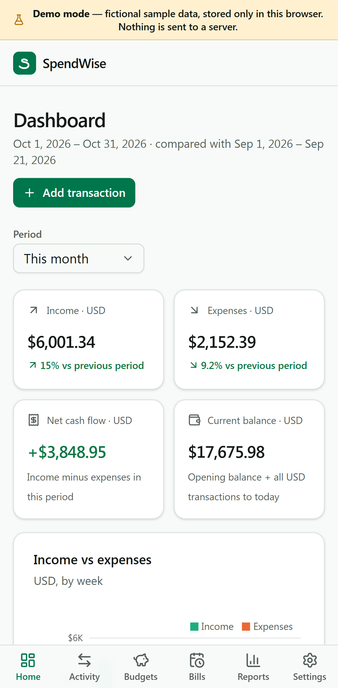

# SpendWise

SpendWise is a bilingual (English / العربية) personal finance web app.

- You record income, expenses, refunds and transfers across your own accounts, in any currency.
- It tracks expected income, keeps invoices and receipts with on-device text recognition, and imports bank statements after you review them.
- Planning tools cover budgets, bills, goals, debts and cash flow.
- Every figure is calculated only from your own records.

- Real accounts use **Firebase Authentication and Cloud Firestore**, with restrictive security rules. Invoice files can optionally use **Cloud Storage**.
- A separate **demo mode** runs entirely in the browser with fictional data.
- The app is a static site built for **GitHub Pages**, with hash routing and a configurable base path.



| Landing | Dark theme | Mobile |
| --- | --- | --- |
|  |  |  |

All screenshots come from the app's production build. The dashboards show fictional demo data.

## Features

- **Arabic and English**
  - The full interface is translated, with right-to-left layout in Arabic and Arabic plural rules.
  - Numbers and dates are formatted for each language (`ar-EG` in Arabic).
  - The language toggle is in the header; the choice is saved on the device and in the account.
  - Amount fields accept Arabic-Indic digits (٠–٩).
- **Accounts (sign-in)**
  - Sign up with a show/hide password toggle and live password rules, sign in with "keep me signed in", reset a password, and verify an email.
  - Edit your name, sign out, or delete your account together with all of its data.
  - Protected `#/app` routes return you to the requested page after sign-in.
- **Demo mode**
  - Entered only through "Try the demo" (`#/demo`).
  - Fictional, Egypt-first sample data stored in `localStorage` (`spendwise.demo.v2`), in English or Arabic.
  - Editable, with reset, clear and exit controls.
  - Demo data is never uploaded, never mixed with real accounts, and never seeded into a real account.
- **Money accounts**
  - Bank accounts, cash, debit and credit cards, mobile wallets, PayPal and others, each with its own currency and opening balance.
  - **Transfers** between your own accounts (including card repayments, ATM withdrawals and wallet top-ups) are never counted as income or expenses.
  - **Credit cards** show the amount owed, available credit, statement and due days, and minimum payment. Only the **last 4 digits** are ever stored.
  - Each account shows its recorded balance, plus totals per currency.
  - An honest connection-status panel for each provider (see [Integrations](#integrations)).
- **Transactions**
  - Four types: income, expense, refund and transfer. A refund reduces spending; it is not income.
  - Search, combinable filters (type, category, currency, account, origin, reconciled, dates, amounts, payment method), sorting, pagination and CSV export.
  - A reconciled flag, and category suggestions learned from your own history.
- **Income**
  - Income sources (salary, freelance, rent, one-off) with an expected amount and a schedule.
  - Expected and received amounts are always kept apart.
  - Partial receipts and overpayments are tracked, and overdue payments are flagged.
  - Income is never marked as received automatically.
- **Invoice center**
  - Add documents by camera (on phones), file picker, or drag and drop (on desktop). Supported files are JPEG, PNG, WebP, PDF (up to 5 pages), JSON and XML, up to 10 MB.
  - Images can be rotated and cropped.
  - **On-device text recognition** (Tesseract.js, English + Arabic). The language data is self-hosted, so nothing is sent to an OCR service.
  - **Structured formats** are read exactly: Egyptian ETA e-invoice / e-receipt JSON, ETA receipt QR links, UBL 2.1 / Peppol XML, and Saudi ZATCA QR codes.
  - Every extracted field is shown for review, with the line it came from.
  - Warnings flag arithmetic mismatches and duplicates (same file, same number, or same amount and date).
  - Statuses (unpaid, partially paid, paid, overdue, cancelled) come from the linked payments.
  - Matching payments are suggested, and each link needs your confirmation.
  - Tax summary and merchant summary, warranty and return dates, and CSV export.
  - A QR code is **not** treated as proof that a document is official. The app shows the link so you can check it on the official portal yourself.
- **Statement import**
  - CSV, or text-based PDF (best effort), with a column-mapping wizard that recognises English and Arabic headers, signed or debit/credit amounts, and Arabic digits.
  - Every row is reviewed before import. Rows already imported, possible duplicates and invalid rows start excluded.
  - Imported rows get deterministic IDs, so importing the same file twice adds nothing.
  - Import history, with a one-click rollback for each batch.
- **Dashboard**
  - Income, expenses (net of refunds), net cash flow and recorded balances per currency, compared with the previous period.
  - Expected income, card debt, budgets, upcoming bills, recent activity, and rule-based insights (plain calculations, not AI).
- **Budgets**: monthly limits per category and currency, with near-limit and over-budget states. Overlapping budgets are blocked.
- **Recurring bills**: weekly, monthly, quarterly or yearly, each with a usual account. "Mark paid" records exactly one expense per occurrence, from the account you choose.
- **Planning tools**
  - Savings goals with contributions, including emergency-fund coverage.
  - Debts with payments and a payoff estimate, plus a credit-card payoff planner.
  - A 60-day financial calendar and a 90-day cash-flow estimate.
  - A printable monthly report, and data-quality checks.
- **Global search** (Ctrl/⌘ K) across transactions, income sources, invoices, budgets, bills, accounts and categories, with type filters.
- **Multiple currencies and exchange rates**
  - All ISO 4217 currencies, stored as integer minor units.
  - Different currencies are never added together implicitly.
  - Converted totals are opt-in and display-only, using [Frankfurter](https://frankfurter.dev) (ECB reference rates). Each one shows its rate, date and source.
- **Layouts**: desktop sidebar, tablet icon rail, and a mobile bottom bar with a "More" sheet. The header has search, Quick add, language, theme and the account menu.
- **Settings**: appearance (theme and language), preferences, opening balances, categories, CSV export, JSON backup and validated restore, and account controls.
- **PWA**: installable. The service worker caches only the app’s own hashed build files, never Firebase, API responses or financial records.

## Integrations

Researched on 2026-10-21 from official sources only; see [docs/RESEARCH.md](docs/RESEARCH.md) for every source and detail.

| Provider | Status in SpendWise | Why |
| --- | --- | --- |
| Egyptian banks | Statement import (CSV / PDF) | No public personal account-information API or open-banking framework was confirmed. |
| InstaPay | Manual entry | No public API for personal transaction history. |
| Vodafone Cash and other wallets | Manual entry | No public API for personal transaction history. |
| PayPal | Activity CSV import | The Transaction Search API needs a server-side secret, and this app has no backend. |
| Credit and debit cards | Manual entry, or the issuer's statement | No card networks or issuers are connected. |
| ETA e-invoices / e-receipts | Read from files and QR codes you provide | ETA APIs are only for registered taxpayers' ERP/POS systems. |

**No live connection to any bank, wallet or payment provider is active.** SpendWise never asks for bank passwords, PINs, OTPs, full card numbers or CVVs, never scrapes portals, and never automates logins.

## Technology

React 19 · TypeScript 6 (strict) · Vite 8 · Tailwind CSS 4 · shadcn/ui (Radix) · Lucide · React Router 8 (`HashRouter`) · Firebase 13 (Auth, Firestore, optional Storage) · Recharts 3 · React Hook Form + Zod 4 · date-fns 4 · Tesseract.js 7 · pdf.js 6 · jsQR · Vitest 5 + Testing Library · Playwright · Firebase Emulator Suite.

## Requirements

- **Node.js 22.12+** (24 LTS recommended; see `.nvmrc`) and npm 11+. Use `npm ci` for reproducible installs.
- Optional:
  - **Java 21+** for the Firebase emulator tests.
  - **Microsoft Edge** for Playwright. To use Playwright's own Chromium instead, run `npx playwright install chromium` and set `PW_CHANNEL=chromium`.

## Getting started

```bash
npm ci
npm run dev        # http://localhost:5173 → landing page; "Try the demo" works without Firebase
npm run dev:demo   # opens the demo directly
```

To use real accounts locally, copy `.env.example` to `.env.local`, fill in your Firebase web config, and restart.

## Environment variables

| Variable | Purpose |
| --- | --- |
| `VITE_FIREBASE_API_KEY`, `VITE_FIREBASE_AUTH_DOMAIN`, `VITE_FIREBASE_PROJECT_ID`, `VITE_FIREBASE_STORAGE_BUCKET`, `VITE_FIREBASE_MESSAGING_SENDER_ID`, `VITE_FIREBASE_APP_ID` | Firebase web app config. This is public configuration, not secrets: security comes from Authentication and the rules. |
| `VITE_FIREBASE_CLOUD_FILES` | `true` stores invoice files in Cloud Storage, which needs the Blaze plan and the deployed `storage.rules`. Otherwise files stay on the device in IndexedDB, and only their metadata syncs. |
| `VITE_BASE_PATH` | Deployment sub-path, e.g. `/spendwise/`. The Pages workflow sets it automatically. |
| `VITE_USE_FIREBASE_EMULATORS` | `true` connects to local emulators. It is honoured only on localhost. |

`.env*` files are ignored by Git except `.env.example` (placeholders) and `.env.emulator` (a fake `demo-*` project for tests).

- Never put service-account keys, admin credentials or any privileged API secret in a `VITE_` variable: those values end up in the public bundle.

**"Accounts aren't available on this deployment"** means the build had no Firebase configuration. The landing page and demo still work, and the app never silently switches to demo data. To enable accounts, follow the Firebase setup below.

## Firebase setup

1. Create a project in the [Firebase Console](https://console.firebase.google.com) and **register a Web app**. Copy its config into `.env.local` locally, or into repository variables for Pages.
2. **Authentication → Sign-in method → Email/Password: enable.**
3. **Authentication → Settings → Authorized domains:** add your Pages host, e.g. `USERNAME.github.io`.
4. **Firestore Database → Create database** in production mode.
5. Optional, invoice files in the cloud: upgrade to **Blaze** (Cloud Storage requires it for projects created since February 2026), then create the default bucket and set `VITE_FIREBASE_CLOUD_FILES=true`.
6. Deploy the rules:

   ```bash
   npx firebase login
   npx firebase use --add        # writes .firebaserc (git-ignored)
   npx firebase deploy --only firestore:rules,firestore:indexes   # add ,storage when using Cloud Storage
   ```

### Data model

```
users/{uid}/settings/preferences          currency, locale, language, date format, week start, opening balances
users/{uid}/categories/{id}
users/{uid}/transactions/{id}             bill payments: bill_{billId}_{due} · income receipts: inc_{sourceId}_{due}_{n} · imports: imp_{account}_{key}
users/{uid}/accounts/{id}                 last 4 digits only
users/{uid}/incomeSources/{id}
users/{uid}/invoices/{id}                 file metadata only (name, type, size, SHA-256, private path)
users/{uid}/imports/{id}
users/{uid}/budgets/{id} · recurringBills/{id} · goals/{id} · debts/{id}
Storage: users/{uid}/invoices/{invoiceId}/{sha256}.{ext}   (only with VITE_FIREBASE_CLOUD_FILES)
```

Amounts are positive integers in the currency's minor unit, with an ISO 4217 `currency`. Dates are `YYYY-MM-DD`, and timestamps come from the server.

### Security rules

- **Firestore (`firestore.rules`)**
  - Only the owner can read or write `users/{uid}/…`. Unknown collections and the parent document are denied.
  - Every write is validated: exact fields, types, amounts, currencies, dates and enumerations.
  - A transfer needs two different accounts. A category's type is immutable. Card numbers are limited to 4 digits.
  - Deterministic IDs make bill payments, income receipts and import rows idempotent.
- **Storage (`storage.rules`)**
  - Only the owner can read or delete their invoice files.
  - Uploads must be named by their SHA-256, be at most 10 MB, and be a JPEG, PNG, WebP, PDF, JSON or XML file. Everything else is denied.
  - Files are opened through authenticated SDK downloads, never through public URLs.

## GitHub Pages deployment

`.github/workflows/deploy.yml` runs on pushes to `main`. It runs typecheck, lint and unit tests, then builds with `VITE_BASE_PATH=/<repo>/` and deploys with the official Pages actions.

1. **Settings → Pages → Source: GitHub Actions.**
2. To enable real accounts: **Settings → Secrets and variables → Actions → Variables**, and add the six `VITE_FIREBASE_*` values. Add `VITE_FIREBASE_CLOUD_FILES` too if you use Cloud Storage.
3. Add `USERNAME.github.io` to Firebase **Authorized domains**.
4. Push to `main`.

## Tests

| Command | What runs |
| --- | --- |
| `npm run typecheck` | `tsc -b` (strict) |
| `npm run lint` | ESLint with typescript-eslint and React Hooks / Compiler rules |
| `npm test` | Vitest unit and component tests. They cover money, finance (transfers, refunds, card balances), income schedules, invoice text extraction (synthetic English and Arabic receipts), ETA / UBL / ZATCA parsers, statement import, tools, insights, backup, search, dictionary parity (en/ar), and pages in both languages. |
| `npm run test:coverage` | The same, with V8 coverage |
| `npm run test:rules` | Firestore and Storage rules tests, plus the real repository against the Auth, Firestore and Storage emulators. Needs Java 21+. |
| `npm run test:e2e` | Playwright on a production build: demo journeys on desktop, tablet and mobile, Arabic/RTL, income, invoices, statement import, search and layout overflow |
| `npm run test:e2e:firebase` | Playwright against the emulators: registration, persistence, sign-out, protected routes and cross-account isolation |

Automated tests use the emulators or the demo only, never real accounts. The camera can't be exercised in automated tests: camera capture uses the browser's file input with `capture`, and the tests upload synthetic images instead.

## Security and privacy

- Ownership is enforced server-side by the rules, and the emulator tests prove one user can't access another's data.
- OCR, PDF reading, QR decoding and statement parsing all run in the browser. Documents are uploaded only when Cloud Storage is enabled, and then only to the user's private path.
- Firestore uses an in-memory cache. The service worker never caches financial data.
- Nothing is created from an invoice or statement without your review and approval.

## Known limitations

- There are no live bank, wallet or PayPal connections (see [Integrations](#integrations)).
- OCR accuracy depends on image quality. Every field must be checked before saving.
- PDF statement layouts vary by bank, so text-based PDF import is best effort. Scanned PDFs need OCR through the Invoice center instead.
- Conversions use ECB reference rates, which don't cover EGP, SAR, AED and some other currencies. Their totals stay separate.
- There are no background reminders: due bills and expected income show up when you open the app.

## Troubleshooting

| Problem | Fix |
| --- | --- |
| "Accounts aren't available on this deployment" | Set the `VITE_FIREBASE_*` variables (`.env.local` or repository variables) and rebuild. |
| `auth/operation-not-allowed` | Enable Email/Password sign-in in Firebase. |
| `auth/unauthorized-domain` | Add the host to Authorized domains. |
| Permission denied | Deploy `firestore.rules` (and `storage.rules`) to the same project. |
| Invoice files say "kept on this device" | This is expected without `VITE_FIREBASE_CLOUD_FILES=true`. Files don't sync between devices. |
| Text recognition is slow the first time | The OCR engine and the English and Arabic language data (about 4.6 MB of language data) download once from the site itself, then come from the browser’s HTTP cache. |
| Emulator tests fail to start | Install Java 21+ and check `java -version`. |
